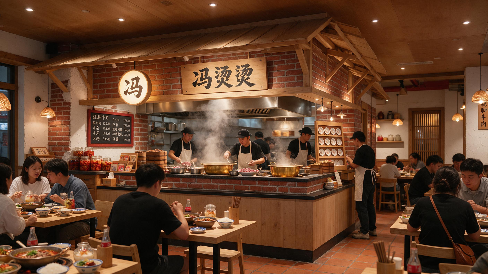
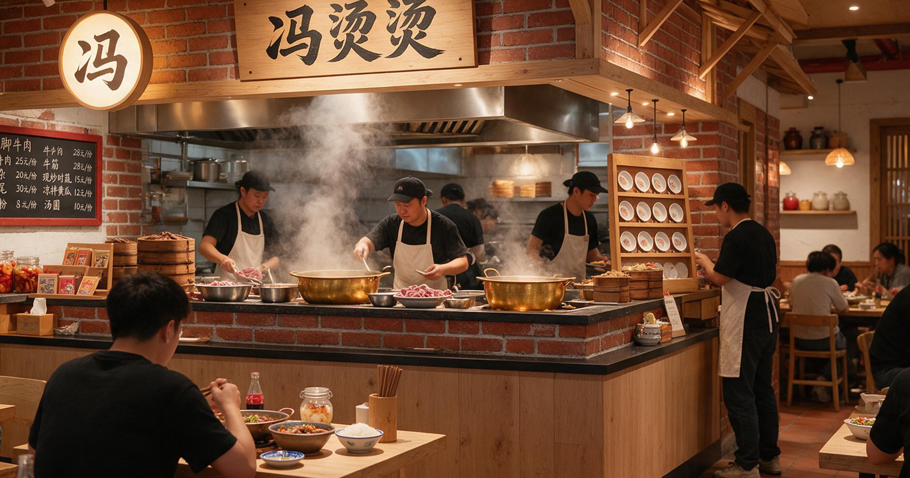

# 社区明档 · 暖黄偏暗 + 红砖木构

- slug：community-wok-warm-dim
- 风格作用域：市井烟火 / 社区明档小馆
- 品牌 / 品类：冯烫烫 · 乐山跷脚牛肉
- 场地：临街社区底商，堂食为主（自有项目）

## 喜欢的三点

1. 暖光只压在桌面、明档台面和招牌上，天棚与背景留暗，不做整体均匀亮。
2. 明档台体用红砖砌到腰线，上方木构坡屋顶把不锈钢排烟罩包进去，烟罩只露一条水平金属檐口，不做独立金属体。
3. 色彩只三档：红砖/赤陶地砖（主）、偏黄旧木（次，桌面与门架）、黄铜大锅与暖光（点缀）；品牌字只在招牌与菜单板上出现，不做大面积品牌色。
4. 边界：暖光只压到桌面可读为止，不做整体压暗；图内菜单数字价格是模型编的，不可当价格依据。

## 当时否掉了什么

- 白墙 + 均匀明亮（v1）：像商场快餐，没有社区烟火气。
- 红黑金属大烟罩当主视觉（v1）：设备抢了品牌的位置。
- 玻璃封断明档（v2）：失去现做的信任感。
- 整体压暗成酒馆（v2）：暖黄不等于昏暗，仍要可读。
- 图内生成乱码文字（v5/v7）：in_image 只保证能出字，不保证字对。

## 落地与修改

- 是否落地：已落地为冯烫烫 v8 验收图（2026-10-28，项目 3b5b03c0-915a-41aa-9c54-4ffaa166ab88）。
- 落地后改了什么：这一版没有改构图；仅切换为 in_image，图中品牌文字直接入画。
- 本条目第 1 张是验收原图，第 2 张是同一张图的明档局部裁切（便于看锅具、蒸汽与台面材料）。
- 边界：图内菜单数字价格是模型编的示意，不是客户真实菜单；不要当价格依据。

## 图片

