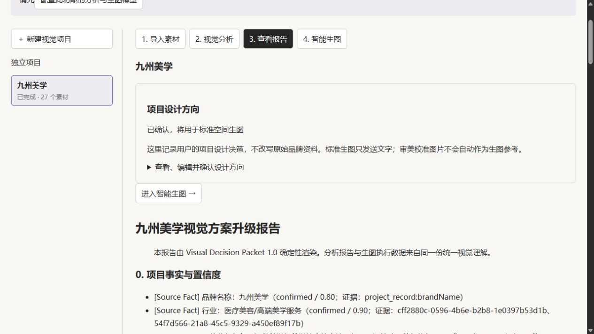

# 九州美学 P7 审查报告

2026-10-20 Asia/Shanghai。**P7 空间契约离线表达未通过；实际视觉质量未测试，等待单独授权。**

能力审查与新隔离副本六字段网页保存确认已完成。首次正式编译触发SPACE_PROMPT_BUDGET_BLOCKED：12124 > 12000；同时保留7500质量预算、10000长度警告。依附件G4停止，不再精简重编译，也不改生产门禁。实际Adapter请求预演未执行，真实生图、Qwen、其他收费调用均0。

- [能力审查](P7-capability-audit.md)：文字数组能表达拓扑，不能锁定几何。
- [空间契约](P7-layout-contract.md)：五节点、服务递进、独立工作台相向席位、珠光建筑职责。
- [完整前后字段](P7-field-diff.md) / [机器差异](P7-field-diff.json) / [正式网页确认记录](P7-confirmed-direction.json)。
- [编译失败原值](P7-compile-error.json) / [Prompt交付状态](P7-prompt-output-status.json) / [请求证据与未执行边界](P7-request-evidence.json)。
- [保护与回归](P7-protection-and-gates.md) / [屏幕后期审查提案](P7-screen-composite-feasibility.md) / [下一次前检](P7-next-image-preflight.md)。

网页上方模型配置提示源于只配置了独立离线图像占位项、未配置分析服务；不影响已分析副本的方向保存确认。没有重新分析或加载真实凭据。网页“已确认”表示数据确认，不表示编译/视觉验收通过。

附件要求的成功Prompt与实际请求证据因G4阻断未能完成，已明确列为未交付，未拿旧P6证据代替。本轮已停止项目修改及生成流程，等待用户审核；无合并、发布或远程推送。
