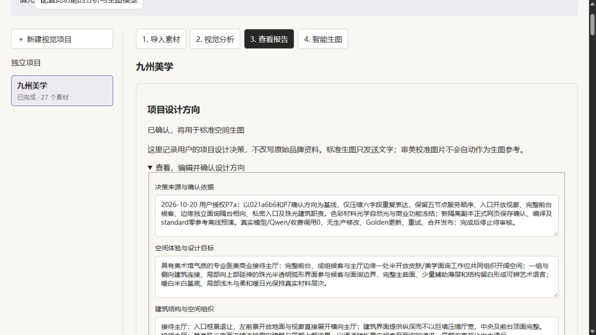

# 九州美学 P7a Prompt 长度修复报告

2026-10-20 Asia/Shanghai。**P7a 空间契约离线表达通过；实际视觉质量未测试，等待单独授权。**

从021a6b6的P7已确认方向复制新隔离项目，只精简六字段同义重复，未回退P6、重新分析或改变空间设计。完整前台/成组候客可见句、五节点清单、自然光、色彩、材料及珠光光学原值冻结。通过正式React网页与Node Host保存并确认，未手写确认JSON或绕过分析新鲜度。

| 成果 | 实际长度 | SHA256 |
|---|---:|---|
| [正式Prompt全文](P7a-formal-prompt.txt) | 10451 | 031d2d20b203d73b5a11b77c27792bde9b02a15cc912c8e0c5f2d9f8dd886ab9 |
| [Provider Prompt全文](P7a-provider-prompt.txt) | 10554 | a7b402054cc0153517dd3d2411668fe0d1583f89c9c9eb3b8f30b6d64edfdc97 |

正式全文比P7阻断值12124减少1673字符，两份均低于11500。Provider仅添加既有103字符前缀，正式全文为其完整后缀，无截断。既有预算状态pass，但仍原样保留SPACE_PROMPT_ABOVE_QUALITY_BUDGET（10451 > 7500）和SPACE_PROMPT_LONG（10451 > 10000）。未达到9500目标；为继续保护独立语义与冻结字段，本轮不扩大压缩范围。[完整预算/字节/摘要](P7a-budget-and-hashes.json)。

- [精简前后完整差异及逐字段理由](P7a-field-diff.md) / [机器差异](P7a-field-diff.json) / [每条旧行合并去向](P7a-deletion-and-merge-ledger.json)。
- [空间关系保真说明](P7a-semantic-fidelity.md) / [13类关键要求两份Prompt行号证据](P7a-layout-semantic-fidelity.json) / [38项字段保真](P7a-field-fidelity.json)。
- [正式确认记录](P7a-confirmed-direction.json) / [网页保存确认请求](P7a-web-input-requests.json)。
- [标准零参考预演证据](P7a-request-evidence.json) / [实际Adapter body](P7a-provider-request.json) / [任务契约](P7a-task-contract.json)。
- [全部工程门禁](P7a-gate-results.json) / [保护和测试报告](P7a-protection-and-tests.md) / [逐目录保护证明](P7a-protection-proof.json)。

实际Adapter路径使用volcengine / doubao-seedream-5-0-pro-260628，2K、16:9、count=1、generationBasis=standard、referenceAssetIds=[]，body无image。先通过现有compile，再通过现有generation-only start进入Adapter，注入fetch在.invalid端点内存截获并返回纯白fixture；fixture不是设计输出、不展示、不作为视觉证据。所有外网模型fetch封锁，真实模型及Qwen调用0。没有复制真实凭据；仅新副本OFFLINE占位配置。

本轮有3次受控离线编译与3轮网页保存确认，非自动重试。前两次长度均10449且编译成功，但既有保真断言分别指出句号与逗号分句后原句不能完整匹配；仅修改functionalRelationships这两处连接符，最终10451并完整通过。详细记录和失败日志见[P7a-iteration-record.json](P7a-iteration-record.json)。生产检查函数、断言与预算均未更改。

页面模型配置提示源于没有配置分析服务；已分析隔离副本的保存确认成功，且没有触发重新分析。网页确认表示项目数据生效，不代表真实图像质量。

剩余风险：文字契约不是几何布局锁定；模型仍可能画出同侧椅或遮挡主厅。通用“No artistic installation”句仍有解释歧义，详见保真说明。屏幕精确后期替换仍只保留P7审计提案，未实施。下一步必须先人工审核字段/全文/请求与这些风险，任何真实生图或Qwen校验都需另行授权；不得自动重试、合成、合并或发布。完成本轮离线证据后停止。
